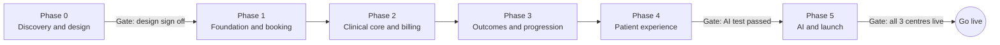

# Clinic Mx: Product Requirements Document (PRD)

20 October 2026 · Velyx Labs

## 1. Overview

Clinic Mx is the clinic management platform for Movementology Clinics' three Bangalore centres (HSR Layout, Koramangala, Whitefield). It runs each patient's whole episode, from a WhatsApp booking to the 12 month follow up, and gives physiotherapists diagnosis suggestions drawn from Padmanaban Sekaran's knowledge base. Velyx Labs builds it, delivered under the Orange Production brand.

**Problem today.** Bookings are handled by hand on WhatsApp, safety screening and consent depend on staff memory, outcomes are not measured consistently, and 20 to 30 years of clinical expertise lives in one person and nine workbooks rather than in the daily workflow of every physio.

### Goals

| # | Goal | How we know |
| --- | --- | --- |
| G1 | Every visit, payment and message belongs to one clinical episode | 100% of sessions linked to an active episode and plan of care |
| G2 | No treatment without screening, consent and pricing | 100% red flag documentation (SOP KPI); software blocks the session otherwise |
| G3 | Every physio reasons like the clinic's best consultant | AI preparation sheet on every new consultation; right diagnosis in top 3 tracked monthly |
| G4 | Outcomes measured, not assumed | Baseline and discharge scores on every episode; meaningful change by 6 weeks in over 85% (SOP KPI) |
| G5 | Fewer steps for patients and staff | Booking in 2 billed WhatsApp messages; health form about 5 minutes; session note under 3 minutes |
| G6 | Low running cost | About ₹8,500 to ₹10,500 a month for hosting, AI, WhatsApp and extras |

### Product principles

1. **The clinical episode is the backbone.** Packages, invoices and messages sit beside it and can never close clinical care.
2. **Software enforces the gates**, not staff memory: consent, pricing, screening, signing, criteria.
3. **AI suggests, clinicians decide.** AI is for clinicians, traceable to a knowledge base row, and never makes safety, money or clearance decisions.
4. **Clinical knowledge is versioned data**, editable without code changes.
5. **Everything is auditable:** form versions, signed notes amended by addenda, alert lifecycles.
6. **Progress by criteria, not calendar.**
7. **Mobile first** for every role. This is the top priority.
8. **English only** across the software, forms, consent and WhatsApp.
9. **Clinical advice is separate from sales.** Declining a package never limits clinical information.

### Source documents

- Patient Journey Software Blueprint v1.1 (17 Oct 2026): the main reference for behaviour.
- Consultation SOP, Red Flag Screening Framework, Sports Specific Diagnosis tables.
- Nine regional and tissue Assessment and Management workbooks (354 condition rows): the clinical knowledge base.
- The client's original Clinical Management Software note.
- Decisions agreed in the journey walkthrough (October 2026), recorded throughout this PRD.

## 2. Users and roles

Clinic Mx has five staff roles, two clinical ticks and centre assignment; patients never get a login. Each staff member has exactly one role, and permissions are fixed per role (no custom permission editor).

### Staff roles

| Role | Who | Core job |
| --- | --- | --- |
| Super Admin | Owner / clinical director | Everything across all centres; setup; the only editor of the knowledge base |
| Centre Manager | Runs one or more centres | Operations, rosters, alerts, outcomes, complaints; no finance beyond a "payment pending" flag |
| Front Desk | Reception | Bookings, check in, health form and consent on the tablet, explaining prices, collecting payment |
| Physiotherapist | Every physio, junior or senior | Treatment sessions, notes, progress; with the Consultant tick also consultations |
| Finance | Accounts | Bills, packages, refunds, unpaid balances, revenue across all centres; no clinical access |

### Clinical ticks

| Tick | Unlocks | Given to |
| --- | --- | --- |
| Treats patients | Read full clinical records; write and sign notes | All physios automatically; a manager or the owner only if they treat |
| Consultant | AI preparation sheet, first consultations, diagnosis, plan of care, return to sport clearance, discharge | Senior physios who do consultations |

Signing any clinical record requires the Treats patients tick. Each user is assigned centres and sees only those; Super Admin and Finance see all three.

### Access summary

| Area | Super Admin | Centre Manager | Front Desk | Physiotherapist | Finance |
| --- | --- | --- | --- | --- | --- |
| Setup: clinics, staff, templates | Full | Rosters and leave | No | Own leave | No |
| Prices, packages, discount types | Full | View | View | No | Full |
| Calendar and bookings | Full | Full | Full | Own schedule; book a patient's next session | No |
| Check in, health form, consent | Full | Full | Full | View | No |
| Patient name and contact | Full | Full | Full | View | View |
| Full clinical records | Full | With Treats tick | No | Full, own centres | No |
| AI preparation sheet | Consultant tick | Consultant tick | No | Consultant tick | No |
| Diagnosis, plan, clearance, discharge | Consultant tick | Consultant tick | No | Consultant tick | No |
| Session notes and progress | Treats tick | Treats tick | No | Yes | No |
| Red flag alerts | All | All in their centres | "Clinician review needed" banner only | Full | No |
| Bills and payments | Full | "Payment pending" flag, no amounts | Create bills, collect | "Sessions left" only | Full |
| Discounts and refunds | Full | No | Preset discounts only | No | Full |
| Dashboards | All | Clinical and operations, own centres | Today screen | Own patients | Finance |
| Knowledge base | Edit and approve versions | View | No | Used through the app | No |
| Audit log and data export | Full | Clinical audit, own centres | No | No | Finance audit |

### Account and security rules

- Individual email logins only; no shared accounts. The shared clinic tablet runs in kiosk mode for patients and needs no staff login.
- Two step verification for every role except Front Desk (optional there).
- Auto logout after 15 minutes of inactivity on desktop computers.
- Staff who leave are deactivated, never deleted; their signed records stay attributed.
- Temporary physios get an access end date.
- Velyx support access is off by default; the Super Admin grants it, time limited and logged.

### Patients

Patients use WhatsApp (booking, reminders, rescheduling Flow) and personal secure links (health form, consent, "My plan", feedback). Records are keyed by person, not phone number, so a family can share one number. Patients under 18 need a guardian's consent and attendance.

## 3. Scope and release phases

Everything in this PRD ships at launch, built in six phases over about 12 weeks, with all three centres going live on the same day.

Phase durations are not to scale; dates are set in the delivery plan.

### What each phase delivers

1. **Phase 0, Discovery and design.** Onsite visits to all three centres; client assets collected; open decisions answered; design system updated; clickable prototypes tested with a receptionist, a consultant and a treating physio; knowledge base clean up starts. Gate: design sign off.
2. **Phase 1, Foundation and booking.** Logins, roles, ticks and centres; patients and episodes; scheduling and calendar; WhatsApp Cloud API, booking and reschedule Flows, templates; front desk booking; check in; health form; Part A consent; red flag rules.
3. **Phase 2, Clinical core and billing.** Consultation stepper and signing; plan of care; Part B consent; price master, packages and billing; treatment sessions; PDFs.
4. **Phase 3, Outcomes and progression.** Questionnaire library and baseline; progress tab; phased programmes and criteria; alerts and tasks; review, discharge and return to sport; dashboards.
5. **Phase 4, Patient experience.** "My plan"; feedback; follow ups; service recovery; review requests.
6. **Phase 5, AI and launch.** Knowledge base import; AI preparation sheet and recheck, switched on only after the blind test passes; similar cases; monthly improvement report; staff training; rehearsal week; opening entries for patients already in treatment; go live; two weeks of close support. Gates: AI test passed, then all three centres live.

### Out of scope at launch

- Native app store apps (an installable web app instead).
- SMS, live chat handover to staff, languages other than English.
- Online payment links through a gateway (open decision 22).
- Voice dictation for notes.
- A trained diagnosis classifier (after 6 to 12 months of data).
- Data migration (no existing data).
- Insurance or corporate billing, inventory, payroll.
- Marketing campaigns (they would need separate consent).

## 4. Patient journey requirements

The journey has seven stages; each requirement below has an ID used in the feature ticket list.

### Stage 1: Booking

- **J1.1** Patients book on the Movementology WhatsApp number through a WhatsApp Flow: clinic, date (only days with free slots), live free time, physio with fee shown, name of the person coming, confirm.
- **J1.2** The assistant's first reply offers three options: Book appointment, Reschedule or cancel, Talk to our team. "Talk to our team" returns the front desk phone number and email; there is no live chat handover.
- **J1.3** On confirm, the slot is checked again and booked; if taken, the Flow shows the next free times. A slot is held briefly while the patient chooses.
- **J1.4** One confirmation message: appointment ID, date, time, physio, clinic map link, fee payable at the clinic, "arrive 10 minutes early", bring reports, front desk number. No health form link and no SMS.
- **J1.5** Front desk books callers and walk ins on the same booking engine; the patient gets the same WhatsApp confirmation. Every booking records its channel and who made it.
- **J1.6** Reminders the day before (with Confirm and Reschedule buttons) and at 8:00 AM on the day, to every patient. Confirm sets the appointment to Confirmed.
- **J1.7** Rescheduling uses the same Flow with clinic and physio prefilled. The old slot is released only after the new one is booked.
- **J1.8** No overbooking. After 2 reschedules or 2 verified no shows, self booking is blocked and the patient is asked to call; the front desk can still book them.
- **J1.9** Emergency words in a chat get emergency advice and the clinic number instead of a booking.
- **J1.10** Phones that cannot open Flows get the front desk number.

### Stage 2: Check in and health form

- **J2.1** Front desk checks the patient in (Checked in, arrival time recorded); the physio is notified.
- **J2.2** Check in generates a QR tied to the appointment, or opens the form on the clinic tablet in locked kiosk mode.
- **J2.3** Health form screens: Part A consent; about you; your problem (region, body chart, complaint, onset, how it started, duration, pain now and with activity 0 to 10, aggravating and easing); warning signs (back adds bladder, bowel and saddle questions; neck adds dizziness and vision questions); health check (pregnancy shown only for female); activity and goal; history with optional report photo; check and submit.
- **J2.4** Warning sign and health check screens are mandatory; other fields can be completed by the physio.
- **J2.5** Assisted mode records which staff member helped.
- **J2.6** On submit: the clinical episode is created, answers and consents saved with form versions, red flag rules run, precautions stored, the AI preparation sheet generated.
- **J2.7** Under 18 opens a guardian section; the guardian signs and must attend.
- **J2.8** Returning patients get prefilled details with "Has anything changed?". A new problem means a new consultation and a new episode.
- **J2.9** "Running late" shows at 15 minutes past start; the front desk can mark a no show from 25 minutes. Both are settings.

### Stage 3: Consultation

- **J3.1** The consulting physio (Consultant tick) reviews the AI preparation sheet before calling the patient in.
- **J3.2** Consultation screen sections: Subjective, Screening, Objective, Assessment, Plan, Sign. Everything autosaves.
- **J3.3** Region specific red flag and precaution screening is mandatory; the record cannot be signed without it.
- **J3.4** Objective entry uses side by side measures (automatic deficit or LSI), special test rows (test, result, interpretation) and 0 to 3 quality ratings.
- **J3.5** "Recheck with findings" reranks the AI suggestions on demand.
- **J3.6** Four part working diagnosis: tissue diagnosis from the knowledge base, movement diagnosis, irritability (suggested from pain), stage (from duration). The client's diagnosis category is coded automatically.
- **J3.7** Plan: goals (including the patient's own), interventions, modalities checked against precautions, frequency, home programme, review dates, outcome questionnaires.
- **J3.8** "Explain to patient" view shows clinician approved content for the diagnosis.
- **J3.9** Signing locks the record; later changes are addenda. Unsigned notes are flagged at end of day.
- **J3.10** A red flag found puts the episode On hold, generates a referral letter and sends safety advice on WhatsApp.

### Stage 4: Plan, pricing, consent and payment

- **J4.1** On signing, the summary PDF is generated and sent with "Open My plan" and "Rate your visit" buttons in one WhatsApp message.
- **J4.2** The front desk sees the recommended plan read only and payment options calculated from the price master: pay per session or a package.
- **J4.3** The patient's choice (package, per session, think about it, no thanks) is recorded against the recommended plan. Declining keeps all clinical information.
- **J4.4** Part B consent on the patient's phone via QR (tablet as backup): general terms always; package terms only with a package; modality statements only for planned modalities.
- **J4.5** Declining a modality removes only that modality; declining a general term blocks treatment; declining a package term blocks the package only.
- **J4.6** The consultation fee is collected after the consultation (a setting). Payment at the counter by the clinic's UPI QR, card machine or cash; the front desk marks it paid. Prices cannot be edited at the desk.
- **J4.7** Paying activates the package (sessions, expiry 3 months from payment, reschedule allowance), creates the invoice and WhatsApp receipt, and moves the episode to Active.
- **J4.8** "Book plan sessions" books the whole series at once, resolving clashes on the spot; one WhatsApp message lists the dates.
- **J4.9** No treatment session can start until Part B consent and pricing are recorded.

### Stage 5: Treatment sessions and progress

- **J5.1** One tap check in shows "Session n of N, consent and payment complete".
- **J5.2** The treating physio sees a summary card from the signed plan; no AI sheet.
- **J5.3** The first session records the baseline: consultation measures within 7 days count; outcome questionnaires are filled by the patient on their own phone and scored automatically.
- **J5.4** Session note in under 3 minutes on a phone: since last visit, mandatory "Any new symptoms?", pain sliders, treatment given (prefilled from last time), modality parameters, response, home programme, next session.
- **J5.5** Closing a session completes it, uses a package session and signs the note.
- **J5.6** Day after first treatment check: Better, Same, Still sore. "Still sore" alerts the physio. Session 3 check message.
- **J5.7** Patients tick home exercises on "My plan"; adherence fills the next note.
- **J5.8** Progress tab: pain line, LSI bullet graphs, questionnaire lines with a meaningful change band.
- **J5.9** Automated alerts become tasks for the consultant; closing one records the decision.
- **J5.10** Reassessment due at session 4: the treating physio measures, the consultant reviews and signs.
- **J5.11** Phases unlock when exit criteria are met; the treating physio progresses within the plan; overrides and plan changes are consultant only, with justification.
- **J5.12** No show handling: "Running late", confirmed no show, WhatsApp message plus a call task, counter updated. Two missed in a row add a clinical review task; the episode is never auto closed.

### Stage 6: Review, return to sport and discharge

- **J6.1** A 6 week Review appointment with the consultant is booked automatically with the plan.
- **J6.2** Final testing uses exactly the baseline markers.
- **J6.3** Readiness panel: every criterion Met, Not met or Not assessed; no clearance while anything is Not assessed.
- **J6.4** Three separate statuses: rehabilitation complete, return to training, return to sport.
- **J6.5** Clinician override with written justification, shown on the report. Patients acknowledge clearance and warning signs on their phone.
- **J6.6** Mandatory discharge reason from a fixed list; non attendance is never counted as recovered.
- **J6.7** Discharge report PDF sent on WhatsApp; "My plan" switches to maintenance mode.

### Stage 7: Feedback and continuity

- **J7.1** Discharge feedback on WhatsApp the same day: 4 questions plus a 0 to 10 recommendation score.
- **J7.2** Negative answers or scores 0 to 6 create a service recovery task; complaints and adverse events escalate to the clinical director within 24 hours.
- **J7.3** Google review requests go to every discharged patient, never only to happy ones.
- **J7.4** Follow ups at 2 weeks, 6 weeks, 3 months and 12 months with Doing well, Some pain, Injured again.
- **J7.5** "Injured again" records a recurrence and alerts the consultant; recurrence after discharge opens a new linked episode.
- **J7.6** Records are shared across all three centres.

## 5. Functional requirements by module

Sixteen modules deliver the journey; each must work fully on a phone.

| ID | Module | Must do | Main users |
| --- | --- | --- | --- |
| M1 | Patients and episodes | Patient record keyed by person (several patients per phone number); OP number; episodes with statuses (Intake pending, Awaiting consultation, On hold, Plan proposed, Active, Under review, Discharged with reason, Lost to follow up); linked recurrence episodes; records shared across centres | All staff |
| M2 | Scheduling and calendar | Physio availability and leave; appointment types with configurable length (Consultation, Session, Review, Zero Gravity Treadmill); day view with a column per physio; agenda view on phones; live updates; slot hold and recheck; no overbooking; reschedule and no show counters; package reschedule allowance | Front desk, physios, managers |
| M3 | WhatsApp | Meta Cloud API direct; booking and reschedule Flows with live slots; approved English templates (confirmation, reminders, summary, receipts, checks, feedback, follow ups, no show, package expiry); AI assistant for typed messages; emergency phrase handling; delivery status tracking | Patients, system |
| M4 | Intake and consent | Appointment linked QR and tablet kiosk; health form with conditional screens; Part A and Part B consent with statement versions, timestamps and signatures; guardian consent; modality consent added later; assisted mode | Patients, front desk |
| M5 | Clinical record | Consultation stepper (Subjective, Screening, Objective, Assessment, Plan, Sign); structured measures; four part diagnosis; provisional vs confirmed; signing with clinician tick; addenda; referral letters | Consultants |
| M6 | AI clinical support | Preparation sheet; recheck with findings; Keep and Dismiss; similar confirmed cases; must rule out; disposition logging; explain to patient content | Consultants |
| M7 | Plan of care | Goals, interventions, modalities with precaution checks, frequency, home programme from the exercise library, review dates, assigned outcome questionnaires, treating physio; versioned plans; propose and approve changes | Consultants, physios |
| M8 | Billing, packages and payments | Price master; packages with 3 month validity; consultation fee by physio level; bills at fixed prices; counter payment recording (UPI QR, card, cash); preset discounts; refunds and credits by Finance; YTP balances; invoices and WhatsApp receipts; package expiry reminders | Front desk, Finance |
| M9 | Treatment sessions | Check in gate; session notes; modality parameters; adverse events; package usage on completion; "Same as last time" | Physios |
| M10 | Outcomes and progression | Questionnaire library with versions, raw answers and automatic scoring; side by side measures and LSI; phased programmes per region with entry and exit criteria; locked phases with reasons; overrides with justification; three clearance statuses | Physios, consultants |
| M11 | Alerts and tasks | Red flag alerts with lifecycle (raised, reviewed, referred, closed); progress alerts; call tasks; service recovery tasks; every task closed with a decision | Physios, managers, front desk |
| M12 | Documents | A4 PDFs on letterhead: consultation summary, invoice and receipt, referral letter, discharge report; versioned and stored | All staff, patients |
| M13 | Patient pages | Health form, consent, "My plan" (diagnosis in plain words, exercises with videos, appointments, package balance, pain and progress, maintenance mode), questionnaires, feedback; secure personal links, no login | Patients |
| M14 | Feedback and follow ups | Post consultation, day after first treatment, session 3, discharge survey, follow ups at 2 weeks, 6 weeks, 3 months, 12 months; recurrence tracking; review requests | Patients, managers |
| M15 | Dashboards and reports | Role dashboards: Today (front desk), My patients (physio), clinical and operations (manager), finance, all centres (Super Admin); monthly knowledge base improvement report | Managers, Finance, Super Admin |
| M16 | Administration, audit and data | Clinics, staff, roles, ticks, centres, end dates; settings; knowledge base versions; template management; audit log of record views and changes; support access grants; data export and deletion requests | Super Admin |

## 6. AI requirements and learning loop

AI understands free text, suggests clinical hypotheses from Padmanaban's knowledge base and writes plain language; it never decides safety, money, scheduling or clearance.

### Where AI is used

| Use | What it does | Who sees it |
| --- | --- | --- |
| AI preparation sheet | Ranks likely diagnoses from a shortlist of knowledge base rows; one line reason each | Consultant tick |
| Recheck with findings | Reranks using examination results, on demand | Consultant tick |
| WhatsApp assistant | Understands typed messages, answers FAQs, detects emergency language | Patients |
| Feedback and follow up understanding | Tags themes in free text; routes replies | Managers, physios |
| One time content preparation | Writes plain language explanations, roadmaps and home advice per condition, reviewed by clinicians before use | Patients via physios |

### Never AI

Red flag rules, gates (consent, pricing, signing, clearance), questionnaire scoring, LSI and ratios, readiness verdicts, phase unlocking, prices, invoices, packages, YTP, scheduling and slot availability. These are fixed, tested rules.

### How the preparation sheet works

1. Code filters the 354 knowledge base rows to about 15 to 25 candidates by region, age, sex, onset and duration.
2. Matching high risk rows go to "Must rule out" by rule, whatever the model says.
3. The model ranks the shortlist and returns condition IDs with a one line reason.
4. Code checks every ID exists on the shortlist; anything else is dropped.
5. The discriminating question, special tests and rationale are shown word for word from the knowledge base.
6. The physio keeps or dismisses each suggestion; nothing enters the record until the physio confirms it.

The sheet shows the top 3 suggestions expanded and 2 under "Also consider" (pending client confirmation). Each item is labelled by source: Patient reported, Clinician confirmed, Assistant suggestion, Confirmed diagnosis.

### Learning loop

- Captured from day one: Keep or Dismiss per suggestion; the diagnosis chosen; changes at review; outcome at discharge; recurrence at follow up.
- The learning label is the diagnosis confirmed at review or discharge, not the first impression.
- Monthly report to the Super Admin: suggestions often dismissed, diagnoses the AI missed, diagnoses changed at review. Knowledge base edits go live only as a new version he approves.
- From month one, 3 to 5 similar confirmed past cases (no identifiers) are shown to the model and the physio.
- After 6 to 12 months, a trained classifier for common conditions may be added as a second opinion.
- Feedback never weakens safety: must rule out rows and red flag rules stay fixed.

### Model and privacy requirements

- Provider: OpenRouter, with zero data retention enforced on every request and pinned providers for clinical calls.
- Clinical sheet: a mid tier model chosen by a blind test on 30 to 50 anonymised Movementology cases, scored by clinicians. DeepSeek V4 Pro and GLM 5.3 via US or EU hosts are test candidates; DeepSeek's own API is never used for patient data.
- Other tasks: a small model (Haiku 5.5 or GPT 6 Luna class).
- No names, phone numbers or IDs are sent to any model.
- Every run logs model, knowledge base version, inputs, outputs and dispositions.
- AI running cost target: about $17 (₹1,650) a month at 450 consultations.

## 7. Business rules and settings

Rules marked Setting are changed by the Super Admin without a code release; everything else is fixed behaviour.

| Rule | Value | Type |
| --- | --- | --- |
| Booking channels | WhatsApp Flow (patients) and front desk (calls, walk ins) | Fixed |
| Overbooking | Not allowed | Fixed |
| Consultation length | Unknown; placeholder until the client confirms | Setting |
| Session length | 45 to 60 minutes per the clinic website; per appointment type and physio | Setting |
| Reminders | Day before with Confirm and Reschedule; 8:00 AM on the day to every patient | Fixed |
| Self booking block | After 2 reschedules or 2 verified no shows | Setting |
| Package reschedules | 1 per 10 booked sessions; Zero Gravity Treadmill sessions never reschedulable | Setting |
| Running late | 15 minutes after start | Setting |
| No show allowed from | 25 minutes after start | Setting |
| Consultation fee | Set by the consulting physio's level (₹750 consultation, ₹1,000 senior consultation) | Price master |
| Consultation fee timing | After the consultation (may change to check in) | Setting |
| Payment | At the clinic: UPI QR, card machine or cash; no gateway at launch | Fixed |
| Price edits at the desk | Not allowed; preset discounts only | Fixed |
| Package validity | 3 months from payment date; expiry reminder 2 weeks before | Setting |
| Baseline reuse | Consultation measures within 7 days count as baseline | Setting |
| Reassessment | Session 4; 6 week review with the consultant | Setting |
| Return to sport | No clearance while any criterion is Not assessed; override needs a written reason | Fixed |
| Unsigned notes | Flagged to the Centre Manager at end of day | Fixed |
| Unpaid balance flag | Above 3 unpaid sessions | Setting |
| Follow ups | 2 weeks, 6 weeks, 3 months, 12 months after discharge | Setting |
| Review requests | Sent to every discharged patient | Fixed |
| Language | English only, everywhere | Fixed |
| Auto logout | 15 minutes idle on desktops | Setting |

### Current price master

| Item | Price (₹) |
| --- | --- |
| Consultation | 750 |
| Senior consultation | 1,000 |
| Rehabilitation session | 1,000 |
| Advanced rehabilitation session | 1,500 |
| PEMF | 750 |
| Radial shockwave (RSW) | 750 |
| Focused shockwave (FSW) | 2,000 |
| Zero Gravity Treadmill | 2,000 |
| Laser, dry needling | Awaited from the client |

## 8. Non functional requirements

The system must be phone first, fast on Indian mobile data, secure for health data and reliable during clinic hours across all three centres.

| Area | Requirement |
| --- | --- |
| Mobile first | Every workflow for every role fully usable from 360 px wide; bottom tab navigation on phones; installable as a PWA on staff phones |
| Speed | Screens interactive within 2 seconds on a mid range Android phone on 4G; WhatsApp Flow slot lookups answered in under 2 seconds; AI preparation sheet ready within 15 seconds of form submission |
| Live updates | Check ins, bookings and alerts appear on other staff screens within 2 seconds without refreshing |
| Resilience | Autosave on every clinical field; drafts survive a dropped connection or a locked phone; a paper fallback for launch week |
| Availability | 99.5% monthly during clinic hours (7 AM to 9 PM IST) |
| Data location | Database and serverless functions in Mumbai |
| Security | Encryption in transit and at rest; row level security for roles and centres; two step verification; signed webhooks for WhatsApp; audit log of record views and changes |
| Privacy | DPDP Act 2023 compliant; minimum necessary access; no identifiers sent to AI; zero data retention AI routes |
| Backups | Daily provider backups plus an independent nightly encrypted copy; monthly restore test |
| Accessibility | WCAG 2.2 AA; status never shown by colour alone; touch targets 44 px staff, 56 px patient pages, 64 px kiosk answers |
| Auditability | Every consent, signature, override, discount, refund and alert decision stored with who and when |
| Portability | Standard Postgres, migrations in the repository, weekly exports; able to move hosts within two days |
| Cost | Running cost about ₹8,500 to ₹10,500 a month at current volumes |
| Language | English only |

## 9. Success metrics

The SOP's own KPIs become the product's targets, tracked automatically on the dashboards from launch.

| Metric | Target | Source |
| --- | --- | --- |
| Red flag documentation | 100% of initial assessments | SOP |
| Consultation to treatment conversion | Over 75% | SOP |
| Treatment completion | Over 80% of plans | SOP |
| Meaningful change by 6 week review | Over 85% of patients | SOP |
| Return to sport at or above pre injury level by 12 months | Over 85% of athletes | SOP |
| Reinjury within 12 months | Under 15% | SOP |
| Patient satisfaction | Over 4.5 out of 5 | SOP |
| Net Promoter Score | Over 60 | SOP |
| Right diagnosis in AI top 3 | Tracked monthly; target set after the first 3 months | Product |
| Notes signed same day | Over 95% | Product |
| No show rate | Tracked monthly; falls after reminders go live | Product |
| Booking Flow completion | Over 80% of started Flows | Product |
| Health form completion before consultation | Over 90% | Product |
| Session note time | Under 3 minutes median | Product |

## 10. Open decisions, assumptions and dependencies

Twenty four decisions remain; none blocks the start of the build, but the WhatsApp number and package rules must be settled before launch.

### Open decisions

| # | Decision | Owner | Needed by |
| --- | --- | --- | --- |
| 1 | Which WhatsApp number: current public number or a new one | Velyx with client | A few weeks before launch |
| 2 | Consultation length | Client | Before scheduling build |
| 3 | Number of AI suggestions (top 3 plus 2 under "Also consider") | Client | Before AI build |
| 4 | Acceptable exercise pain: 4/10 (SOP) or 5/10 (workbooks) | Client | Before progression build |
| 5 | Weight loss red flag: over 5 kg in 3 or in 6 months | Client | Before screening build |
| 6 | Morning stiffness red flag: over 30 or over 60 minutes | Client | Before screening build |
| 7 | Who performs the session 4 reassessment | Client | Before progression build |
| 8 | Which sessions and modalities each package covers | Client | Before billing build |
| 9 | Refund policy wording | Client | Before consent build |
| 10 | Partial payments allowed; does an unpaid balance block booking | Client | Before billing build |
| 11 | Does a no show or late cancellation use a package session | Client | Before billing build |
| 12 | Unused sessions at expiry or discharge: lost, extended or credited | Client | Before billing build |
| 13 | Is the 6 week review charged; is the consultation fee charged when referred out | Client | Before billing build |
| 14 | How long an "I'll think about it" plan stays valid | Client | Before billing build |
| 15 | Preset discount types | Client | Before billing build |
| 16 | Laser and dry needling prices | Client | Before billing build |
| 17 | Tax treatment on invoices | Client's accountant | Before billing build |
| 18 | Print the coded diagnosis on the summary, or keep it internal | Client | Before documents build |
| 19 | Lost to follow up period | Client | Before discharge build |
| 20 | Data retention period | Client and lawyer | Before launch |
| 21 | Consent texts for dry needling and Zero Gravity Treadmill; optional marketing tick box | Client | Before consent build |
| 22 | Remote package payment links (gateway fee about 2.36%) | Client | After launch |
| 23 | Regulatory check on diagnosis suggestion software in India | Client's lawyer | Before AI goes live |
| 24 | Ownership of the knowledge base and learned improvements | Client and Velyx | Contract |

### Assumptions

- About 450 new consultations and 2,400 treatment sessions a month across three centres.
- No existing patient data to import; patients already in treatment get an opening entry before launch.
- All three centres launch on the same day.
- Staff use their own phones plus one tablet per centre.

### Client dependencies

- Fix copied text and duplicate rows in four workbooks; add thoracic spine content.
- Provide 30 to 50 anonymised past cases for the AI model test.
- About 12 to 18 hours of clinician time to approve patient content.
- Official logo files and brand gold confirmation.
- Exercise videos, or a plan to film them.
- One tablet per centre.
- Privacy notice, data processing agreements, and licences for paid questionnaires (Oxford scores, WOMAC).
