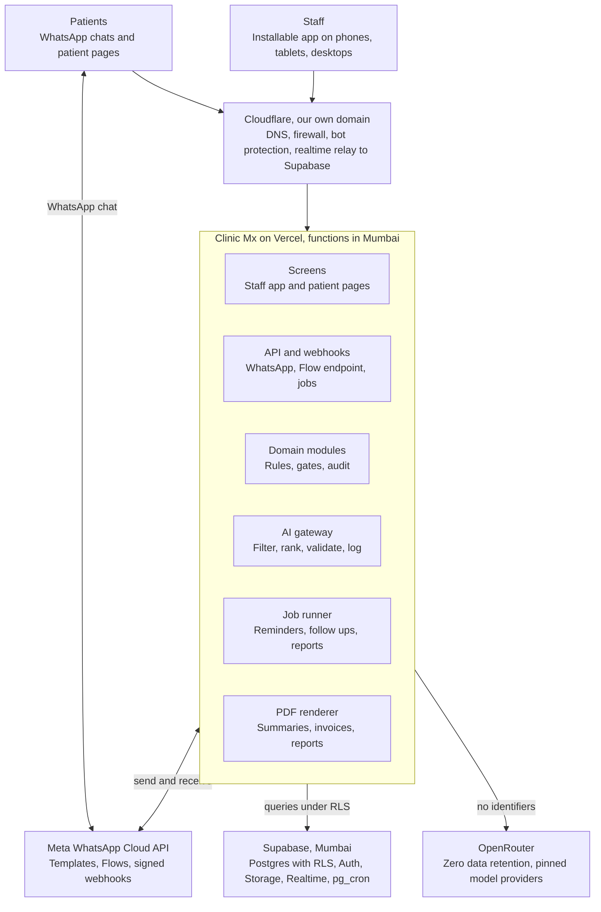

# Clinic Mx: Technical Architecture Document (TAD)

20 October 2026 · Velyx Labs

## 1. Architecture at a glance

Clinic Mx is one Next.js application on Vercel (Mumbai) backed by Supabase Postgres (Mumbai), reached only through the clinic's own domain behind Cloudflare, with Meta WhatsApp and OpenRouter as the two external services.



Patients chat with Meta directly; everything else, including live updates relayed by Cloudflare to Supabase Realtime, goes through our own domain, so a block on a provider's domain in India cannot take the clinics offline.

## 2. Technology stack

One TypeScript codebase on Next.js, hosted on Vercel in Mumbai, with Supabase Postgres in Mumbai as the single source of truth, and Cloudflare in front.

| Layer | Choice | Why |
| --- | --- | --- |
| Web app | Next.js (App Router), React, TypeScript | One codebase for staff app, patient pages and APIs; server rendering for fast first load on phones |
| Styling | Tailwind CSS v4 with the Clinic Mx design tokens; Tailwind defaults removed | Only approved colours and sizes can be used |
| UI primitives | Radix UI, lucide icons | Accessible building blocks without a heavy component kit |
| Forms | React Hook Form + Zod (schemas shared with the server) | One validation rule for client and server |
| Client data | TanStack Query | Caching, retries and optimistic updates on flaky mobile data |
| Charts | Recharts plus small custom SVG components (bullet graph, dumbbell, heatmap, 7 day strip) | Standard charts fast; special charts exact to the design |
| Mobile | Installable PWA with a service worker; offline drafts in IndexedDB | Phone first without app stores |
| Server logic | Next.js Route Handlers and Server Actions on Vercel Functions, region bom1 (Mumbai) | Close to the database; one deploy |
| Database | Supabase Postgres (Mumbai), Small compute | Managed Postgres with backups, auth, storage, realtime |
| Data access | Drizzle ORM with SQL migrations in the repository | Typed queries; plain Postgres for portability |
| Access control | Postgres row level security plus server side permission checks | Roles and centre scope enforced inside the database |
| Authentication | Supabase Auth: email and password, TOTP two step verification, called only from our server | Email logins as agreed; no browser calls to supabase.co |
| Realtime | Supabase Realtime relayed through a Cloudflare Worker on our own domain; 15 second polling fallback | Live calendar and alerts that survive an India DNS block |
| Jobs | Postgres job queue table; pg_cron triggers a secured job endpoint every minute | Reminders, follow ups, expiries without another vendor |
| Files | Supabase Storage private buckets, served through our domain with short lived signed URLs | Reports, PDFs, signatures, exercise videos |
| PDFs | @react-pdf/renderer on the server | Deterministic A4 letterhead documents |
| WhatsApp | Meta WhatsApp Cloud API directly (no reseller), Flows with an encrypted data endpoint | Lowest cost, full control |
| AI | OpenRouter through an internal AI gateway module | Model choice in config; zero data retention per request |
| Edge | Cloudflare DNS, firewall and bot protection (free plan) | Attack protection and our own domain everywhere |
| Email | Transactional email service on a free tier | Staff login and alert emails |
| Monitoring | Sentry (errors), uptime monitor, Vercel and Supabase logs | Free tiers at this size |
| Quality | GitHub, GitHub Actions (lint, types, tests, design token check), Vitest, Playwright on phone viewports, Vercel preview deploys | Every change tested on a phone sized screen before merge |

## 3. Application structure

Clinic Mx is a modular monolith: one deployable app split into domain modules that only talk to each other through their service functions, never through each other's tables.

### Three surfaces, one app

| Surface | Path | Who | Auth |
| --- | --- | --- | --- |
| Staff app | `/app/...` | Five staff roles | Supabase session cookie, two step verification by role |
| Patient pages | `/p/<token>/...` | Patients | Single purpose signed token tied to one appointment or episode; expires |
| Integration endpoints | `/api/whatsapp/*`, `/api/flows/*`, `/api/jobs/*`, `/api/realtime/*` | Meta, pg_cron, relay | Signature or shared secret verification |

### Code layout

```
apps/web
  app/(staff)/...        staff screens by role
  app/(patient)/p/[token] patient pages
  app/api/...            webhooks, Flow endpoint, jobs, health
  modules/
    identity/      users, roles, ticks, centres, sessions, support access
    scheduling/    availability, appointments, slots, holds, counters
    patients/      patients, guardians, episodes, opening entries
    intake/        health form, conditional logic, Part A consent
    clinical/      consultation, screening, measures, diagnosis, signing, addenda
    knowledge/     knowledge base versions, conditions, rules, programmes
    ai/            gateway, preparation sheet pipeline, dispositions, reports
    care/          plan of care, modalities, precautions, Part B consent
    billing/       price master, packages, bills, payments, discounts, refunds
    sessions/      treatment sessions, notes, adverse events
    outcomes/      questionnaires, scoring, criteria, phases, clearances
    tasks/         alerts, tasks, decisions
    messaging/     WhatsApp client, templates, Flows, delivery status
    documents/     PDF templates and rendering
    engagement/    feedback, follow ups, recurrence, reviews
    reporting/     dashboard queries, KPIs, exports
    audit/         audit events, record views
  packages/
    ui/            design system components and tokens
    schemas/       Zod schemas shared by client and server
    db/            Drizzle schema, migrations, RLS policies, seed
```

### Conventions

- **Every write goes through a module service function** that checks permission, validates with Zod, writes inside a transaction and records an audit event.
- **State changes are explicit transitions** (for example `appointment.checkIn()`), each with a guard that enforces the gate.
- **Settings live in a `settings` table** read through one cached function; no magic numbers in code.
- **Knowledge base content is data**, loaded from versioned tables, never hard coded.
- **IDs are UUIDs**; human facing numbers (OP number, appointment ID, bill number) come from per centre sequences.
- **All times are stored in UTC** and shown in IST.
- **Money is stored in paise as integers.**

## 4. Data model

The episode is the backbone: appointments, consultations, plans, sessions, outcomes and documents all hang off an episode, while bills and packages link to it without owning it.

### Core entities

| Entity | Key fields | Belongs to / links |
| --- | --- | --- |
| `centre` | name, address, map link, phone, colour | none |
| `staff_user` | email, name, role, treats_patients, consultant, active, access_ends_at | centres (many) |
| `support_grant` | granted_by, starts_at, ends_at, reason | staff_user (Super Admin) |
| `patient` | name, dob, sex, phone, email, occupation, op_number | phone is not unique |
| `guardian` | name, relationship, phone | patient |
| `episode` | body_region, status, opened_at, closed_at, discharge_reason, linked_episode_id | patient, centre |
| `appointment` | type, starts_at, ends_at, status, channel, booked_by, arrived_at, confirmed_at | patient, centre, physio, episode (optional) |
| `slot_hold` | expires_at | appointment slot |
| `booking_counter` | reschedules, no_shows | patient |
| `intake_response` | form_version, answers (JSON), submitted_at, assisted_by | episode, appointment |
| `consent_record` | stage (A or B), statement_key, statement_version, accepted, signed_at, signature_file, signer (patient or guardian) | patient, episode, modality (optional) |
| `red_flag_alert` | rule_key, tier, status, raised_at, reviewed_by, decision, closed_at | episode |
| `consultation` | sections (JSON), status, signed_by, signed_at | episode, appointment |
| `measure` | kind, side, value, unit, position, taken_at | episode, consultation or session |
| `special_test_result` | test_key, result, interpretation | consultation or session |
| `diagnosis` | condition_id, kb_version, movement_dx, irritability, stage, category_code, provisional | consultation |
| `addendum` | text, author, created_at | consultation or session |
| `ai_run` | kind, model, kb_version, input_hash, output (JSON), latency_ms, cost | episode |
| `ai_suggestion` | condition_id, rank, reason, disposition | ai_run |
| `plan_of_care` | version, goals, interventions, frequency, weeks, review_dates, treating_physio, status | episode |
| `plan_modality` | modality_key, parameters | plan_of_care |
| `price_item` | key, label, amount_paise, active | none |
| `package_type` | sessions, validity_days, reschedules_per_10, covered_items | price items |
| `package` | sessions_total, sessions_used, paid_at, expires_at, reschedules_left, status | patient, episode, package_type |
| `bill` | bill_number, status, total_paise, created_by | patient, episode |
| `bill_line` | price_item, qty, amount_paise, discount_type | bill |
| `payment` | method (UPI, card, cash), amount_paise, recorded_by, recorded_at | bill |
| `refund_credit` | amount_paise, reason, approved_by | bill or package |
| `session` | number, note (JSON), pain, adverse_event, status, signed_by | episode, appointment, package (optional) |
| `questionnaire_result` | instrument_key, version, raw_answers, score, interpretation | episode |
| `criterion_result` | protocol_version, criterion_key, result (Met, Not met, Not assessed), override_reason | episode |
| `clearance` | kind (rehab complete, return to training, return to sport), signed_by, overridden | episode |
| `task` | kind, priority, status, assignee, due_at, decision | episode or patient |
| `message` | template_key, direction, status, wa_message_id, sent_at | patient |
| `feedback` | survey_key, answers, score | patient, episode |
| `document` | kind, version, file, shared_at | episode |
| `audit_event` | actor, action, entity, entity_id, before, after, at, ip | any |
| `setting` | key, value, updated_by | none |

### Knowledge base tables (versioned, read only in the app)

| Entity | Holds |
| --- | --- |
| `kb_version` | version number, approved_by, approved_at, notes |
| `kb_condition` | stable condition ID, region, subregion, name, synonyms, age range, sex predominance, onset, activity tags, symptoms, red flag tier, discriminating question, tests, imaging, biomechanical cause, programme fields, evidence anchor |
| `kb_red_flag_rule` | region, trigger, tier, action text |
| `kb_programme_phase` | condition or region, phase, entry and exit criteria |
| `kb_questionnaire` | instrument, version, items, scoring rule, meaningful change |
| `kb_exercise` | name, video file, default dose |
| `kb_patient_content` | condition ID, explanation, roadmap, home advice, warning signs, approved_by |

Every clinical row stores the `kb_version` it used, so a later knowledge base edit never changes what a past record meant.

## 5. Security, authentication and access control

Access is enforced twice: by permission checks in every server function and by row level security in Postgres, so a bug in one layer cannot leak another centre's or another role's data.

### Authentication

- Staff sign in with email and password through our own domain; the server calls Supabase Auth, never the browser.
- Two step verification (authenticator app, TOTP) is required for Super Admin, Centre Manager, Physiotherapist and Finance; optional for Front Desk.
- Sessions are HTTP only, secure, same site cookies. Desktop sessions expire after 15 minutes idle; phone sessions persist behind the phone lock.
- Deactivating a user or reaching `access_ends_at` revokes sessions immediately.
- Patients never log in. Patient links carry a signed, single purpose token (health form, consent, "My plan", questionnaire, feedback) that expires; "My plan" links can be reissued from WhatsApp.

### Authorisation model

- **Role** (one per user) decides screens and actions; **ticks** (Treats patients, Consultant) unlock clinical actions; **centres** limit rows.
- A permission map in code (`role × action`) is the single source; there is no runtime permission editor.
- RLS policies read the user's role, ticks and centres from JWT claims refreshed on change. Examples: clinical tables readable only with `treats_patients`; `ai_run` only with `consultant`; billing amounts never selectable by Centre Manager or Physiotherapist (they read views exposing `payment_pending` and `sessions_left` only).
- Signing a consultation, plan, clearance or discharge checks the tick at the moment of signing and stores who signed.
- Support access for Velyx requires an active `support_grant`; every query under it is audit logged.

### Data protection

- TLS everywhere; Postgres and storage encrypted at rest by the providers.
- Database and functions in Mumbai; files in private buckets served through short lived signed URLs on our domain.
- Every view of a clinical record and every change is written to `audit_event`.
- Signed records are immutable; changes are addenda.
- AI calls receive no names, phone numbers or IDs; zero data retention is enforced per request.
- Webhooks from Meta are verified with the app secret signature; the Flow data endpoint uses Meta's required encryption; the jobs endpoint requires a secret.
- Rate limits on login, patient token endpoints and webhooks; Cloudflare firewall and bot protection in front.
- Secrets live in Vercel and Supabase environment settings, never in code.

### Compliance

- DPDP Act 2023: purpose limited consent (Part A), minimum necessary access, audit trail, data export and deletion requests handled by the Super Admin (deletion may mean anonymising where clinical retention applies).
- Data processing agreements with Vercel, Supabase, OpenRouter and Meta.
- A privacy notice that mentions AI assisted processing.
- An independent penetration test before launch.

## 6. WhatsApp integration

Clinic Mx connects directly to Meta's WhatsApp Cloud API with no reseller; booking and rescheduling run as WhatsApp Flows backed by our live slot data.

### Components

| Component | Role |
| --- | --- |
| `messaging/client` | Sends template and session messages through the Graph API; retries with backoff; records `message` rows |
| `/api/whatsapp/webhook` | Receives inbound messages and delivery statuses; verifies the signature; acknowledges within seconds and queues work |
| Conversation router | Button replies and Flow completions go to fixed handlers; typed text goes to the AI assistant; emergency phrases go to the emergency reply first |
| `/api/flows/booking` | The Flow data endpoint: returns clinics, dates with free slots, free times, physios with fees; places slot holds; books on confirm; Meta encryption |
| Template registry | Every approved English template with its key, category, variables and version |

### Booking Flow sequence

1. Patient messages the number; the router replies with three buttons (billed service message 1).
2. "Book appointment" opens the Flow. Screen 1 asks for clinic and date; the endpoint returns only dates with free consultation slots.
3. Screen 2 asks for time and physio; the endpoint returns live free slots and places a 5 minute hold when one is picked.
4. Screen 3 asks for the name of the person coming and shows a summary.
5. On confirm, the endpoint rechecks the slot inside a transaction, books it, and returns success, or returns the next free times.
6. The confirmation is sent (billed message 2) and the appointment appears live on staff screens.

Endpoint replies must return within a few seconds; slot queries use an index on (centre, physio, starts_at) and precomputed availability windows.

### Templates (English, utility category)

Booking confirmation · front desk booking confirmation · plan sessions list · day before reminder with Confirm and Reschedule (Flow template) · 8 AM reminder · consultation summary with document and buttons · receipt · home programme update · day after first treatment check · session 3 check · no show message · package expiry reminder · discharge report with feedback · review request · follow up checks (2 weeks, 6 weeks, 3 months, 12 months) · safety advice after a red flag.

All automated messages stay strictly transactional so Meta keeps them in the utility category. Marketing messages are out of scope.

### Rules

- One reply equals one message: the assistant never splits an answer into several bubbles.
- Staff phone number and email are returned for "Talk to our team"; no live chat handover.
- Phones that cannot open a Flow get the front desk number.
- A test number is used until the client chooses the production number; templates and Flows are then submitted for approval on the real number, a few weeks before launch.
- Meta billing is set up in rupees before 31 December 2026.

## 7. AI architecture

All AI calls go through one internal gateway; the clinical preparation sheet is a four layer pipeline in which code filters and validates and the model only ranks.

### AI gateway (`modules/ai/gateway`)

- One function per task (`rankDiagnoses`, `recheckWithFindings`, `assistantReply`, `tagFeedback`), each with its model, prompt version, reasoning effort, timeout and token limit in config.
- Calls OpenRouter with `zdr: true` on every request and a pinned provider for clinical tasks.
- Strips identifiers before sending: only age, sex, region, symptoms, duration, sport and goal.
- Structured output with a JSON schema; invalid output is retried once, then the sheet shows "Suggestions unavailable" (the consultation never blocks on AI).
- Prompt caching for fixed instructions.
- Logs every run to `ai_run`: model, prompt version, kb_version, input hash, output, latency, cost.
- A daily spend cap with an alert to the Super Admin.

### Preparation sheet pipeline

1. **Trigger:** health form submitted, as a queued job.
2. **Filter (code):** select `kb_condition` rows by region and subregion, age range, sex, onset and duration; keep about 15 to 25.
3. **Must rule out (code):** add every high risk row whose rule matches, regardless of ranking.
4. **Similar cases (code):** fetch 3 to 5 past episodes with similar answers whose diagnosis was confirmed at review or discharge (no identifiers).
5. **Rank (model):** send compressed rows (matching fields and IDs only) and the case; receive ranked condition IDs with one line reasons.
6. **Validate (code):** drop IDs not on the shortlist; enforce the count; attach question, tests and rationale from the knowledge base word for word.
7. **Publish:** store `ai_run` and `ai_suggestion` rows; notify the consultant's screen.

"Recheck with findings" runs steps 5 to 7 again with the examination results, only when tapped.

### Learning loop

- Dispositions (Keep, Dismiss), the chosen diagnosis, review changes, discharge outcome and recurrence are stored against each run.
- The learning label is the diagnosis confirmed at review or discharge.
- A monthly job builds the improvement report for the Super Admin; knowledge base changes are made as a new `kb_version` he approves.
- After 6 to 12 months, a trained classifier for common conditions can be added behind the same gateway as a second opinion.

### Models

| Task | Model tier | Notes |
| --- | --- | --- |
| Preparation sheet, recheck | Mid tier, chosen by blind test | Candidates: Sonnet 5.5, GPT 6 Sol, Gemini 3.1 Pro; DeepSeek V4 Pro and GLM 5.3 via US or EU hosts with zero data retention |
| Assistant, feedback tags, follow up replies | Small | Haiku 5.5 or GPT 6 Luna class |
| One time patient content | Best available, once | Reviewed and approved by clinicians before use |

The blind test (30 to 50 anonymised cases, scored by clinicians) reruns whenever the model, prompt or knowledge base changes. DeepSeek's own API is never used for patient data.

## 8. Background jobs and realtime

Time based work runs from a Postgres job queue processed every minute; live screens update through Supabase Realtime relayed on our own domain.

### Job queue

- A `job` table holds kind, run_at, payload, attempts, status and an idempotency key.
- pg_cron calls `/api/jobs/tick` every minute with a secret; the handler claims due jobs with `FOR UPDATE SKIP LOCKED`, runs them, and retries failures with backoff (maximum 5 attempts, then a task for the Super Admin).
- Domain events (appointment booked, form submitted, session closed, discharge signed) enqueue follow on jobs in the same transaction.

| Job | When |
| --- | --- |
| Day before reminder | 6:00 PM IST the day before each appointment (time is a setting) |
| Morning reminder | 8:00 AM IST on the day |
| Release expired slot holds | Every minute |
| "Running late" flag | 15 minutes after start, if not checked in |
| AI preparation sheet | On form submission |
| Day after first treatment check | Next day, 10:00 AM |
| Session 3 check | After session 3 closes |
| "I'll think about it" nudge and call task | 2 days after the plan was proposed |
| Package expiry reminder | 14 days before expiry |
| Unsigned notes flag | 9:00 PM IST daily |
| Discharge feedback and review request | Same day, then next day |
| Follow ups | 2 weeks, 6 weeks, 3 months, 12 months after discharge |
| Lost to follow up check | Daily; period is a setting |
| Monthly knowledge base report | 1st of each month |
| Nightly backup copy | 2:00 AM IST |
| Weekly portability export | Sunday 3:00 AM IST |

### Realtime

- Channels per centre (appointments, check ins, alerts) and per user (tasks, notifications).
- The browser connects to `realtime.<clinic domain>`, a Cloudflare Worker that relays the WebSocket to Supabase Realtime, so no clinic device ever resolves a supabase.co address.
- RLS applies to realtime payloads; clients receive only rows they may see.
- If the socket drops, screens fall back to polling every 15 seconds and show "Updated n seconds ago".

## 9. Documents, files and payments

PDFs are rendered on the server from signed records, files live in private storage behind our domain, and payments are recorded at the counter with no gateway at launch.

### Documents

| Document | Built from | Delivered |
| --- | --- | --- |
| Consultation summary | Signed consultation | WhatsApp document template; printable |
| Invoice and receipt | Paid bill | WhatsApp; printable |
| Referral letter | Red flag decision or referral | Printable; shareable link |
| Discharge report | Signed discharge, baseline vs final results | WhatsApp; printable |

- Templates use @react-pdf/renderer on A4 with the Movementology letterhead, readable in black and white.
- Each PDF is stored as a `document` row with a version; regenerating after an addendum creates a new version, never overwrites.
- Numbers use Indian formats (₹18,40,000) and IBM Plex fonts embedded in the PDF.

### Files

| Bucket | Contents | Access |
| --- | --- | --- |
| `reports` | Photos and scans of patient reports | Staff with Treats patients tick, own centres |
| `signatures` | Consent signatures | Audit and legal only |
| `documents` | Generated PDFs | Staff by role; patient via token link |
| `exercise-media` | Exercise videos and images | Patients via token; staff |
| `brand` | Logo and letterhead assets | Public |

Uploads are resized on the client before upload to save mobile data. Signed URLs live for 5 minutes and are issued by our server.

### Payments

- At launch the front desk records counter payments: clinic UPI QR, card machine or cash, with an optional reference number.
- Bills use fixed prices from the price master; only preset discount types can be applied at the desk; refunds and credits need Finance.
- Partial payments create a YTP balance only if the client allows them (open decision).
- The billing module exposes a payment provider interface so a gateway for remote payment links can be added later without changing bills.

## 10. Environments, deployment and reliability

Three environments, automated checks on every change, and backups that are proven by a monthly restore test.

### Environments

| Environment | Purpose | Data | WhatsApp |
| --- | --- | --- | --- |
| Local | Development | Seeded fake data | None |
| Staging | Testing, client review, rehearsal week | Fake data only, never real patients | Meta test number |
| Production | Live clinics | Real data, Mumbai | Production number (to be chosen) |

Vercel preview deployments are created for every pull request against the staging database.

### Deployment

1. Pull request runs lint, type check, unit tests, design token check and Playwright tests on phone and desktop viewports.
2. Merge to main deploys to staging; Supabase migrations apply automatically.
3. A tagged release promotes to production; migrations must be backwards compatible so a rollback is a redeploy of the previous build.
4. Releases go out outside clinic hours (after 9 PM IST) except urgent fixes.

### Reliability and recovery

| Item | Target |
| --- | --- |
| Availability during clinic hours | 99.5% a month |
| Recovery point | 24 hours (provider daily backup) and the nightly independent copy |
| Recovery time | 4 hours to restore service |
| Restore test | Monthly, documented |
| Host portability | Move to another Postgres host (fallback: DigitalOcean Bangalore) within 2 days |

- Point in time recovery is not purchased at launch; revisit if the clinic needs restore to any minute.
- A printed paper fallback (health form, consent) is kept at each centre for launch week and outages.

### Monitoring

- Sentry for frontend and server errors, with patient data scrubbed.
- An uptime check on the app, the Flow endpoint and the jobs tick every minute, alerting the Velyx on call phone.
- Daily checks: failed jobs, undelivered WhatsApp messages, AI errors and spend, slow queries.
- Spend alerts on Vercel, Supabase (spend cap on) and the AI gateway.

## 11. Running cost

The platform costs about ₹8,800 to ₹10,800 a month at about 450 consultations and 2,400 sessions a month (estimates from October 2026 pricing, at about ₹96.5 per US dollar).

| Item | Monthly | Basis |
| --- | --- | --- |
| Hosting: Vercel Pro (1 deploying seat) + Supabase Pro with Small compute + Cloudflare free | ₹4,900 to ₹5,900 | $20 + about $30, plus up to $10 for the realtime relay and backups |
| AI through OpenRouter | about ₹1,650 | Optimised pipeline; about ₹3 per consultation |
| WhatsApp (Meta direct) | about ₹1,730 incl. GST | Utility templates ₹0.115 each; 1,000 free service replies a month; reminders to every patient |
| Extras: domain, WhatsApp number, email, card forex on USD bills | ₹500 to ₹1,500 | Free tiers for monitoring and email |
| Payment gateway | ₹0 at launch | Counter payments only |

**One time:** about $20 to $35 for AI patient content; one tablet per centre; a penetration test; legal work; questionnaire licences where needed.

Costs grow mainly with WhatsApp volume and, past about 10 centres, a larger database compute size.

## 12. Technical risks and mitigations

The two risks that could stop the clinics are an India block of a provider domain and a WhatsApp approval delay; both have designed in mitigations.

| Risk | Impact | Mitigation |
| --- | --- | --- |
| Indian ISPs block a provider domain (Supabase was blocked from 24 Feb to 3 Mar 2026) | Staff and patients cannot reach the app | All browser traffic goes to our own domain; server and realtime relay talk to Supabase; standard Postgres with weekly exports and a documented fallback host |
| WhatsApp template or Flow approval delayed, or the production number decided late | No reminders or booking at launch | Build on a test number; submit on the real number several weeks before launch; front desk booking works without WhatsApp |
| AI suggestions wrong or unavailable | Misleading or missing support | Code filters and validates; must rule out by rule; clinician confirms everything; consultation never blocks on AI; blind test before go live |
| AI provider retains or trains on data | Privacy breach | Zero data retention enforced per request; no identifiers sent; pinned providers |
| Slow phones or weak signal in clinics | Staff fall back to paper | Phone first design, PWA caching, autosave and offline drafts, polling fallback |
| All three centres launch at once | Problems hit every centre together | Rehearsal week on staging, role based training, paper fallback, two weeks of close support with daily fixes |
| Knowledge base errors (copied text, duplicates) | Wrong guidance shown | Clean up in Phase 0; stable condition IDs; versioned, Super Admin approved changes |
| Usage based bills spike | Unexpected cost | Supabase spend cap, Vercel and AI spend alerts, daily AI cap |
| Unclear client policies (packages, refunds, thresholds) | Rework | Every policy is a setting; open decisions tracked in the PRD |
| Regulatory view of diagnosis suggestion software | Launch delay for AI | AI is decision support a clinician must confirm; legal check before the AI gate; the rest of the system launches regardless |
